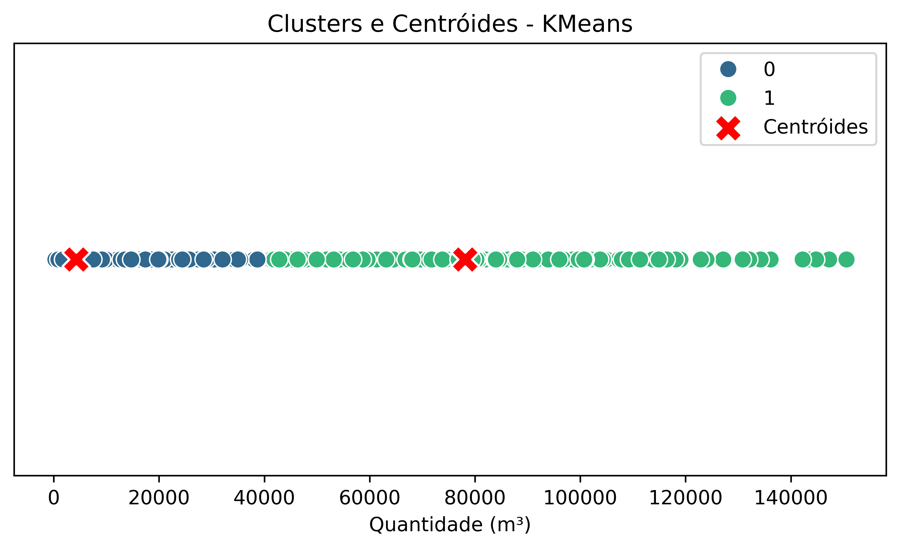
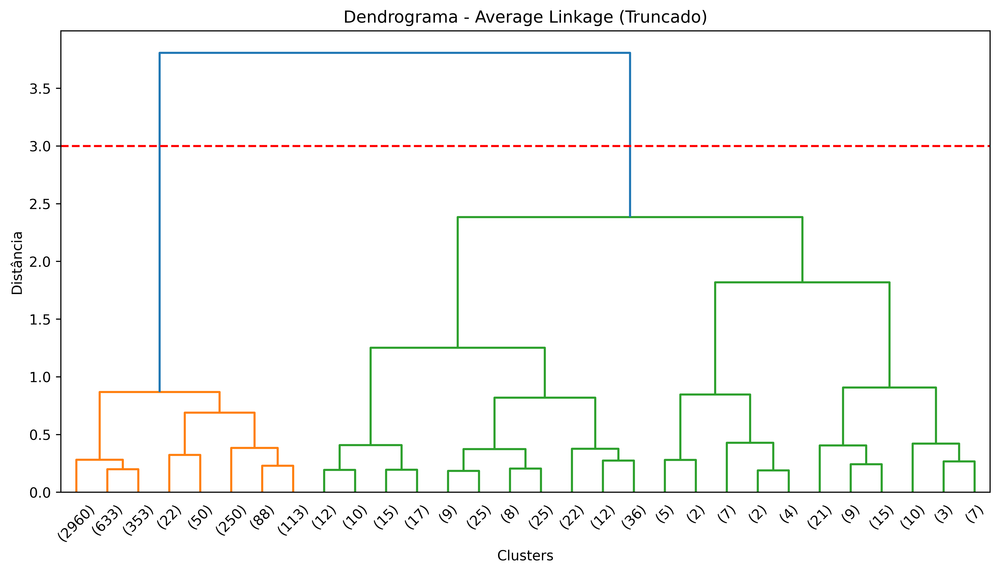
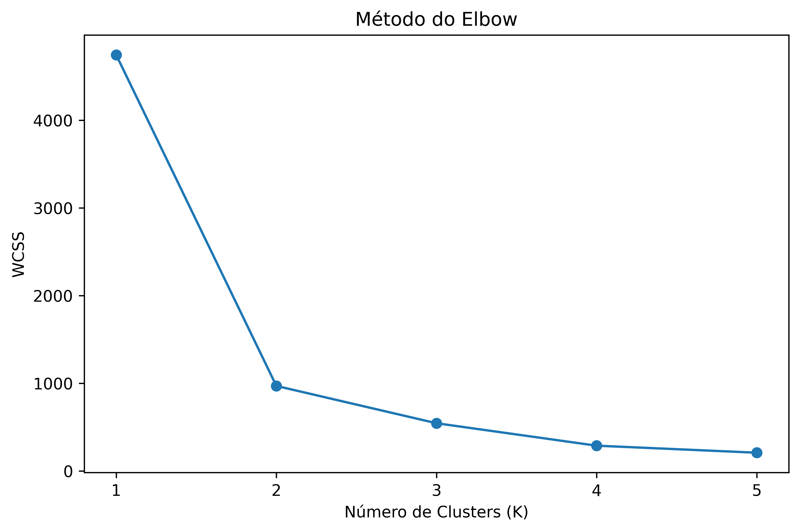
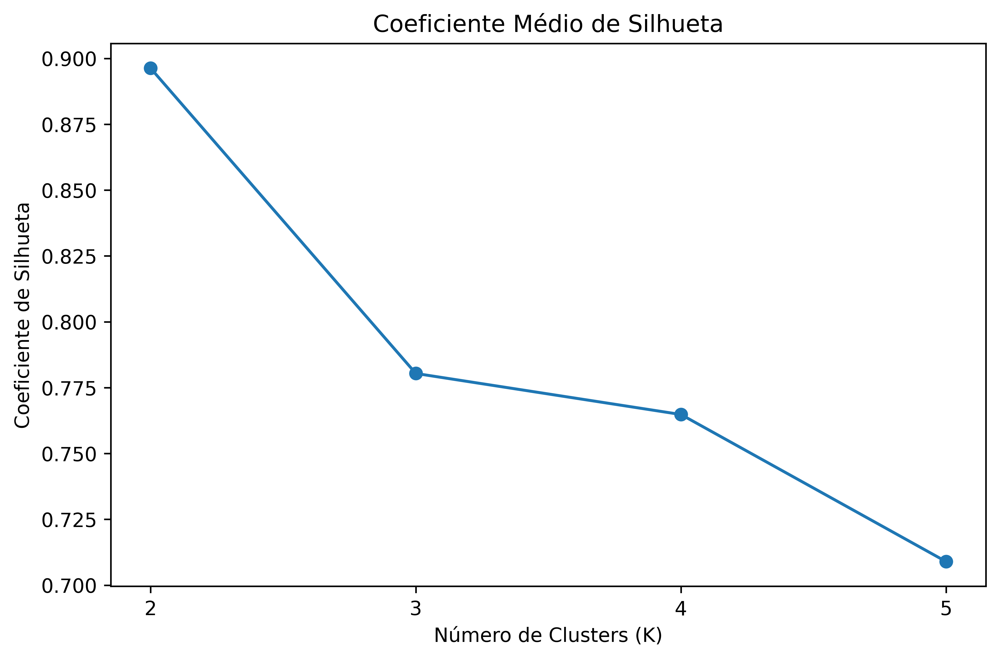

# Unsupervised Machine Learning - Clusterização da Produção de Biodiesel

## 🎯 Sobre o projeto

**O problema:** Quem planeja a compra de insumos ou a oferta de biodiesel precisa saber como o volume produzido se distribui entre os registros de matéria-prima: se ele é parecido entre todos ou se poucos registros concentram a maior parte. Neste projeto usei os dados públicos da ANP para separar os registros por volume, sem definir uma variável resposta, com quatro métodos de clusterização: três hierárquicos aglomerativos (Single, Complete e Average Linkage) e o K-means.

**Quem usaria:** Um cenário plausível é a área de planejamento de compras ou de oferta de um produtor ou distribuidor de biodiesel. O projeto usa dados públicos e não tem cliente real, então esse uso é um cenário, não um caso aplicado.

**O resultado:** Os quatro métodos separam os 4.745 registros em dois grupos: um grande, de volumes regulares, e um pequeno, de volumes muito altos. O grupo de altos volumes tem de 7 a 276 registros, dependendo do método, e é formado em 86% a 99,6% por óleo de soja. O K-means e o Average Linkage concordam em 99,8% dos registros.

**Ressalvas importantes:** os métodos usam uma única variável (o volume), então os clusters são faixas de volume, e não grupos com características diferentes. O número de clusters (2) foi escolhido nos dendrogramas por inspeção visual (veja Limitações).

---

## 📖 Etapas do Projeto

### 1. Coleta dos Dados

- **Fonte:** [Painéis de Produção de Etanol e de Biodiesel](https://dados.gov.br/dados/conjuntos-dados/paineis-de-producao-de-etanol-e-de-biodiesel), ANP
- **Arquivo:** Matéria-Prima utilizada na Produção de Biodiesel (CSV)
- **Período:** jan/2017 a ago/2023 (80 meses)
- **Tamanho:** 4.745 linhas, uma por mês, estado e produto (14 produtos, 14 estados e 5 regiões)

### 2. Metodologia

- Limpeza e padronização dos dados (Python + Pandas) e padronização de `quantidade_m3` pelo Z-score.
- **Hierárquico aglomerativo** (distância euclidiana) com Single, Complete e Average Linkage. Em cada um, olhei o dendrograma truncado e cortei na altura que dá 2 clusters (0,25 no Single, 6 no Complete e 3 no Average).
- **K-means** (não hierárquico, k-means++). Testei de 1 a 5 clusters pelo Elbow (WCSS de 4.744, 970, 544, 288 e 208, sem um cotovelo nítido) e de 2 a 5 pela silhueta, que é maior com k = 2 (0,896, contra 0,780 com k = 3). O modelo final tem 2 clusters.
- Para cada método, descrevi o cluster de grandes volumes: tamanho, mediana, produto predominante e posição em relação aos percentis da base.

### 3. Resultados

Base geral: mediana de 1.849 m³ e média de 8.411 m³. Os percentis 90, 95 e 99 são 19.736, 48.720 e 99.693 m³.

| Método | Registros no cluster de grandes volumes | Mediana (vezes a mediana geral) | Óleo de soja | Menor valor do cluster |
|---|---|---|---|---|
| Single Linkage | 7 (0,15%) | 144.261 m³ (78×) | 6 de 7 (85,7%) | 142.240 m³, acima do p99 |
| Complete Linkage | 118 (2,49%) | 96.450 m³ (52×) | 117 de 118 (99,2%) | 78.004 m³, acima do p95 |
| Average Linkage | 276 (5,82%) | 73.430 m³ (40×) | 275 de 276 (99,6%) | 37.968 m³, acima do p90 |
| K-means | 266 (5,61%) | 74.374 m³ (40×) | 265 de 266 (99,62%) | 41.421 m³, acima do p90 |

- **K-means:** o cluster de grandes volumes tem média de 78.119 m³, cerca de 9 vezes a média geral.
- **Average Linkage e K-means:** todos os registros do cluster passam do p90, e 238 deles passam do p95 (86% dos 276 do Average e 89% dos 266 do K-means).
- **Single Linkage:** o grupo é um conjunto de valores extremos. Inclui o maior registro da base, 150.567 m³ de óleo de milho (Mato Grosso, 11/2019).
- **Convergência:** os clusters do K-means coincidem com os do Average Linkage em 99,8% dos registros, com os do Complete em 96,9% e com os do Single em 94,5%. Os métodos concordam sobre a estrutura (poucos registros de volume muito alto), mas diferem no tamanho do grupo.
- **Síntese:** em todos os métodos os maiores volumes estão concentrados em poucos registros, e o óleo de soja domina esses grupos.

<p align="center">
  
</p>

<p align="center">
  
</p>

<details>
<summary><b>Análise por ano (Average Linkage), Elbow e silhueta</b></summary>

Média de `quantidade_m3` dos registros de óleo de soja que estão no cluster de grandes volumes do Average Linkage, por ano:

| Ano | Registros | Média (m³) |
|---|---|---|
| 2017 | 28 | 58.826 |
| 2018 | 35 | 73.202 |
| 2019 | 41 | 74.602 |
| 2020 | 46 | 80.940 |
| 2021 | 48 | 85.588 |
| 2022 | 48 | 71.304 |
| 2023 | 29 | 86.108 |

Essa média sobe de 2017 a 2021, cai em 2022 e volta a subir em 2023, mas ela é calculada só sobre os registros que já estão no cluster de grandes volumes, e o número desses registros muda a cada ano. Por isso, não é uma medida de crescimento da produção.

<p align="center">
  
  
</p>

</details>

---

## ⚠️ Limitações

- **Uma única variável.** Com só `quantidade_m3`, os clusters são faixas de volume. Não há outra característica (estado, produto, época) definindo os grupos.
- **O número de clusters foi escolhido por inspeção visual.** Os cortes dos dendrogramas (0,25, 6 e 3) foram escolhidos olhando o gráfico, e o Elbow do K-means não tem cotovelo claro. Só a silhueta favorece k = 2, e ela foi testada só de 2 a 5.
- **O Single Linkage forma o grupo por encadeamento.** Os 7 registros do cluster são valores extremos isolados, então servem mais para detectar outliers do que para segmentar.
- **A análise por ano não mede crescimento.** Ela usa só os registros que já estão no cluster de grandes volumes (veja o bloco recolhido acima).

<details>
<summary><b>Outras limitações</b></summary>

- **Há 13 registros com volume zero**, que entram em todos os métodos.
- **O K-means foi rodado com uma única semente** (`random_state=100`), sem teste de estabilidade.
- **Associação, não causalidade.** Os clusters descrevem o período jan/2017 a ago/2023.

</details>

---

## ⚙️ Como Rodar

Testado com Python 3.11.

```bash
pip install -r requirements.txt
cd src
python script_biodiesel.py
```

O script usa caminhos relativos (`../data`, `../outputs`), então precisa ser executado a partir da pasta `src/`. Ele está no formato de células do Spyder (`#%%`) e abre uma janela para cada gráfico. Para rodar sem janelas, use `MPLBACKEND=Agg python script_biodiesel.py`. Os gráficos (PNG) e os HTMLs interativos são gravados em `outputs/`.

<details>
<summary><b>📁 Estrutura do repositório</b></summary>

    unsupervised-learning-clustering/
    ├── data/
    │   └── biodiesel-materia-prima.csv
    ├── src/
    │   └── script_biodiesel.py
    ├── outputs/
    │   ├── dendrograma_single_truncado.png
    │   ├── dendrograma_comp_truncado.png
    │   ├── dendrograma_aver_truncado.png
    │   ├── kmeans_elbow.png
    │   ├── kmeans_silhueta.png
    │   ├── kmeans_centroides.png
    │   ├── hist_quantidade_m3_30.html
    │   └── boxplot_quantidade_m3.html
    ├── requirements.txt
    ├── .gitattributes
    ├── .gitignore
    └── README.md

</details>

---

## 🔗 Projetos relacionados

- [unsupervised-learning-biodiesel-acm](https://github.com/bavsvalle/unsupervised-learning-biodiesel-acm): K-means e Análise de Correspondência Múltipla (ACM) sobre os mesmos dados.
- [supervised-learning-biodiesel-regressao](https://github.com/bavsvalle/supervised-learning-biodiesel-regressao): regressão linear múltipla sobre os mesmos dados.
